Data Atoms 是在瀏覽器裡運作的互動式資料探索工作台：把欄位拖進「編碼槽位」，圖表就即時更新。本手冊依**目前的介面**撰寫，所有截圖都由程式自動擷取。先看「三分鐘上手」，要查某個圖型或槽位的細節，再翻對應章節。

## 三分鐘上手

1. **選資料集**：右上角下拉選單，選「日本 47 都道府縣人口與高齡化」。
2. **清除預設**：按槽位區右上的「✕ 清除」，從空白畫布開始。
3. **拖進 X、Y**：把「都道府縣」拖到 X 軸，「總人口」拖到 Y 軸，長條圖立刻出現。
4. **加維度**：把「地方分區」拖進「色」，每個地區自動換色。
5. **換圖型**：左下「圖表類型」點選 11 種圖型之一，同一份資料換個角度看。
6. **存起來**：按「📌 釘選當前」，再按「🧩 組合看板」，把多張圖排成儀表板。

```callout info 兩種放入欄位的方法
**拖曳**：從左側欄位清單拖到槽位。**快捷鈕**：滑鼠移到欄位上，點 +X、+Y、+色（度量是 +大）、+面、+濾，效果相同。
```

## 認識畫面

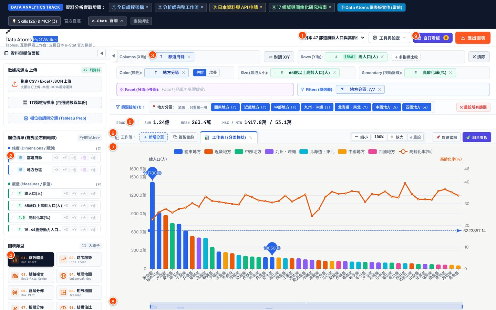

| 編號 | 區域 | 用途 |
|---|---|---|
| 1 | 資料集選單 | 切換 12 組內建資料集，或自選 17 大領域指標 |
| 2 | 欄位清單 | 維度（藍）與度量（綠），拖曳或點快捷鈕指派 |
| 3 | 編碼槽位 | X、Y、色、大小、次軸、面、濾，共七個 |
| 4 | 圖表類型 | 11 種圖型（編號 01–11） |
| 5 | 統計帶 | 目前資料的筆數、總和、平均、最大／最小 |
| 6 | 工作表分頁 | 多張探索圖並存；含縮放、釘選、組合看板 |
| 7 | 圖表區 | 互動圖表，滑鼠移上去顯示數值 |
| 8 | 資料抽屜 | 展開後看原始資料表，可搜尋、匯出 CSV |
| 9 | 自訂看板 | 釘選的圖表集中處，數字是已釘選張數 |

右上角另有「工具與設定」選單（17 領域、欄位分類、圖表引擎、數據簡報、還原預設）與「匯出圖表」（1080p 高清圖）。左上的「Skills (26) & MCP (3)」是課程用的技能與 MCP 工具庫說明，與繪圖操作無關。

## 欄位：維度與度量

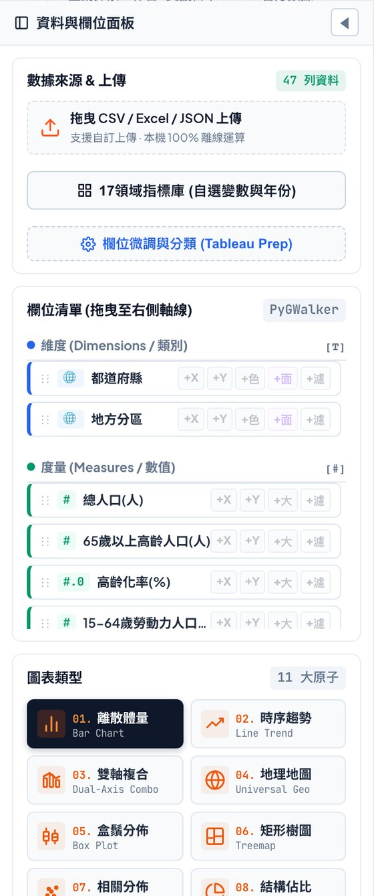

| 類型 | 放什麼 | 圖示 | 預設行為 |
|---|---|---|---|
| 維度（Dimensions） | 地區、年份、姓名等「分組用」的類別欄位 | T、🌐（地理）、Abc | 離散；地理維度預設以 COUNT 計次 |
| 度量（Measures） | 人口、金額、比率等「可計算」的數值欄位 | #（整數）、#.0（小數） | 連續；預設 SUM 加總 |

系統會自動判定每個欄位是維度還是度量。判定錯了（例如把「郵遞區號」當成數字），到「工具與設定 → 欄位微調與分類」手動改：

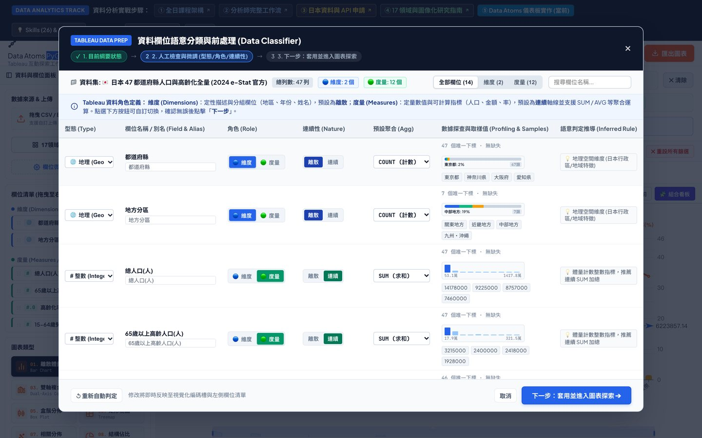

這個視窗可以改每個欄位的**型態**、**角色**（維度或度量）、**連續性**（離散或連續）與**預設聚合**（SUM、COUNT 等）。改完按「下一步：套用並進入圖表探索」；改壞了按左下「重新自動判定」還原。

## 七個編碼槽位

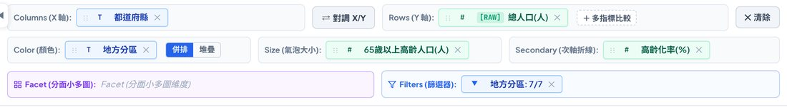

```kv cols=2
X（Columns）: 水平軸，放類別或時間
Y（Rows）: 垂直軸，放要量測的數值，可切換聚合方式
色（Color）: 在同一張圖裡再分組，併排或堆疊
大小（Size）: 氣泡半徑、矩形樹圖的面積
次軸（Secondary）: 疊上一條折線，使用右側自己的刻度
面（Facet）: 切成多張同刻度的小圖（只有長條圖、折線圖支援）
濾（Filters）: 只留下你要的資料列
```

### X 軸：水平定位

- **放維度**（如「都道府縣」「年份」）：每個類別佔一個刻度。長條圖預設依數值**由大到小**排序。
- **X 放度量、Y 放維度**：長條圖自動變成**橫向長條**，適合名稱很長的類別。按「⇄ 對調 X/Y」可以快速互換。
- **X、Y 都放度量**：系統自動切換成散佈圖（07 相關分佈）。

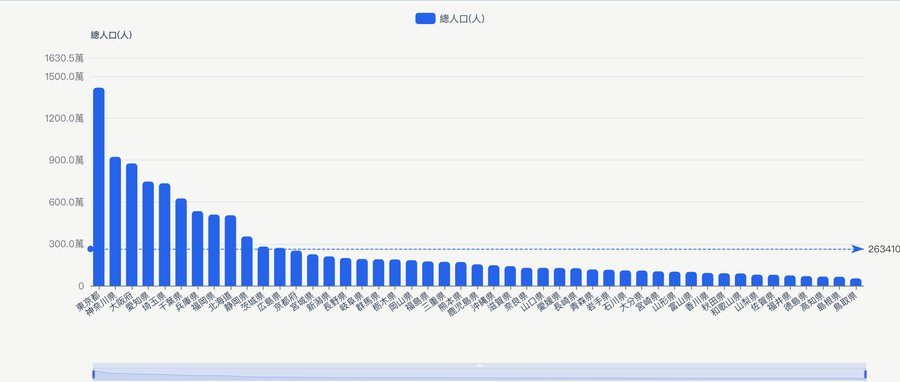

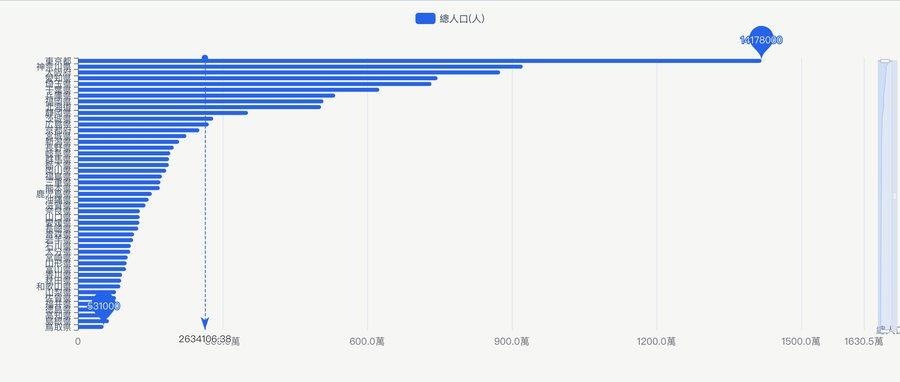

### Y 軸：數值與聚合

Y 軸決定柱高、折線起伏與散佈圖的垂直位置。**點膠囊上的方括號標籤**（如 `[RAW]`）就會切換聚合方式，順序固定為：

`RAW` → `SUM` → `MEAN` → `MAX` → `MIN` → `COUNT` → 回到 `RAW`

| 聚合 | 意思 | 適合 |
|---|---|---|
| RAW | 原始值，逐列不彙總 | 每個 X 只有一筆的明細資料 |
| SUM | 加總 | 金額、人口、數量 |
| MEAN | 平均 | 比率、單價、評分 |
| MAX／MIN | 最大／最小 | 看極端值 |
| COUNT | 計次（有幾列） | 算筆數 |

![點一下標籤後，Y 膠囊由 [RAW] 變成 [SUM]](manual_images/05_agg_pill.jpg)

```callout info 大資料自動保護
原始資料超過 5,000 列、且聚合為 RAW 時，類別圖表會自動改成依 X 軸加總，避免畫面卡頓，並跳出提示。要改回其他方式，點聚合標籤即可。
```

膠囊旁的「＋ 多指標比較」可以一次放入 2 個以上的度量，見「多指標比較」一節。

### 色：同一張圖裡分組

「色」只接受**維度**。放入後，同一張圖裡每個類別換一種顏色。長條圖有兩種排法，用色槽旁的「併排／堆疊」切換：

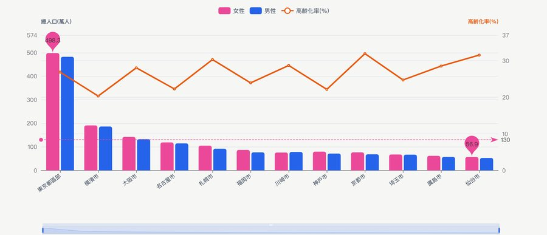

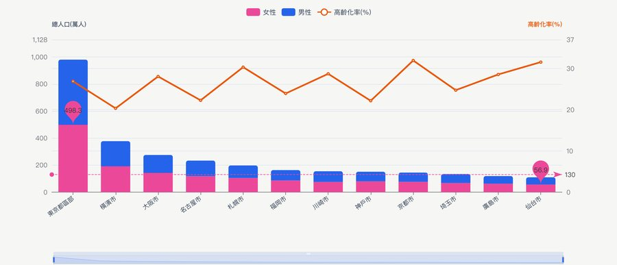

「色」在不同圖型的意思不同，完整對照見「十一種圖型」一節。

### 大小：氣泡與面積

「大小」接受**度量**。散佈圖裡，數值越大氣泡越大；矩形樹圖裡，它決定方塊面積（沒放大小時改用 Y）。

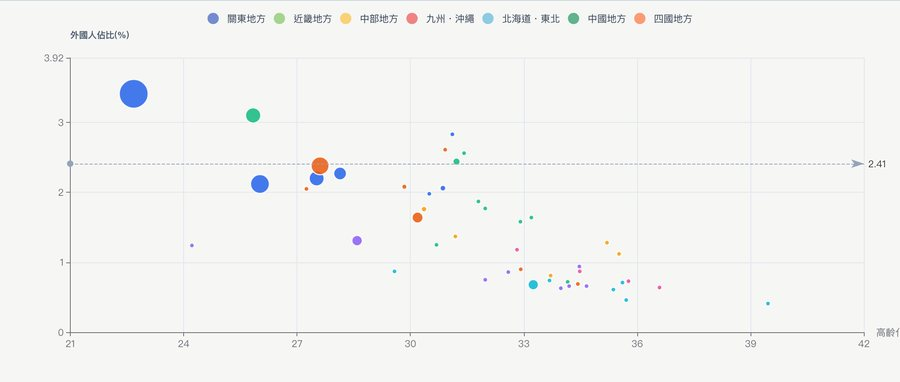

### 次軸：兩種量級並存

當兩個度量的單位或量級差很多（例如「總人口」是幾百萬、「高齡化率」是百分比），把第二個放進「次軸」：長條圖上會疊一條折線，右側有它自己的刻度。

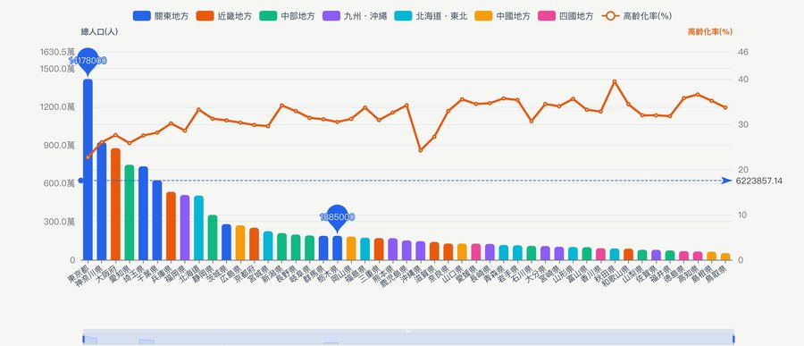

### 面：切成小多圖

「面」接受**維度**，把畫布切成多張**使用同一組 X、Y** 的小圖，逐一比較。兩個限制：

- **只有長條圖與折線圖**會畫小多圖，其他圖型放了「面」也不會分面。
- 面的類別至少要有 2 個。

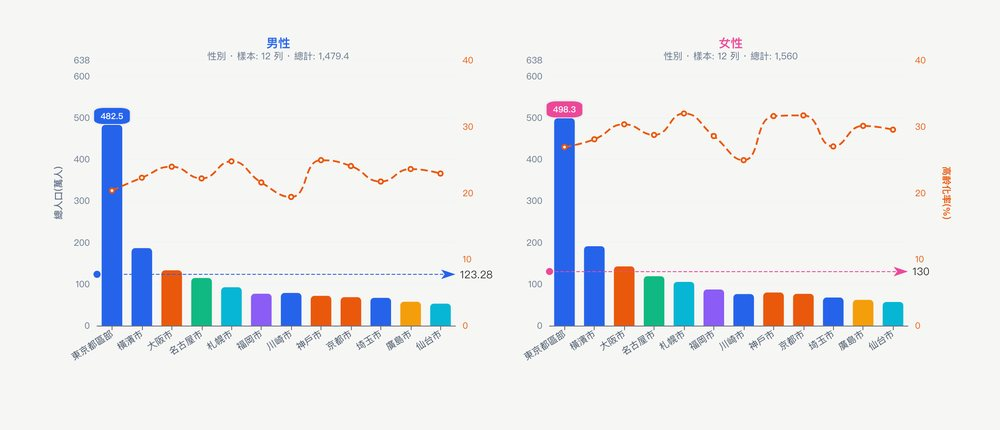

槽位旁的按鈕可切換兩種量表：**🔒 統一量表**（所有小圖共用同一個 Y 軸最大值，高度可直接比較）與 **🔓 獨立量表**（每張小圖依自己的資料縮放，並只保留自己有的類別）。

```callout warn 避坑：X 與「面」不要放有從屬關係的兩個維度
「都道府縣」只屬於一個「地方分區」。X 放都道府縣、面放地方分區時，統一量表下每張小圖都列出全部縣，其中大半是空的（下圖上）；改用獨立量表，每張小圖只留自己的縣、各自縮放（下圖下）。
```

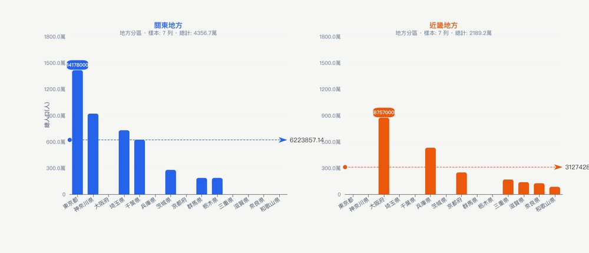

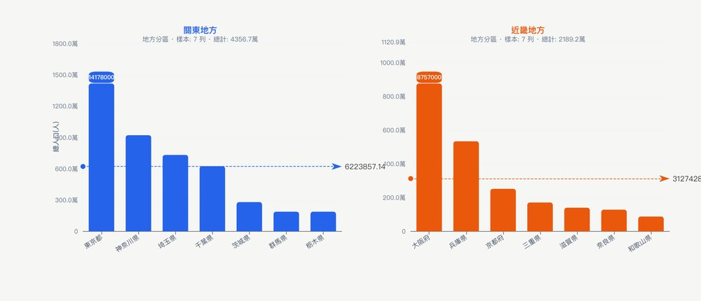

### 濾：只留下要看的

用欄位旁的「+濾」，或把欄位拖進「Filters」。篩選有兩種：

- **類別篩選**：每個類別一顆按鈕，點選切換；另有「全選」「只留第一項」，括號內是該類別的筆數。
- **範圍篩選**（數值或年份）：快速區間按鈕（如「近 10 年」「最新」），或自己填「從 … 至 …」後按「套用」。

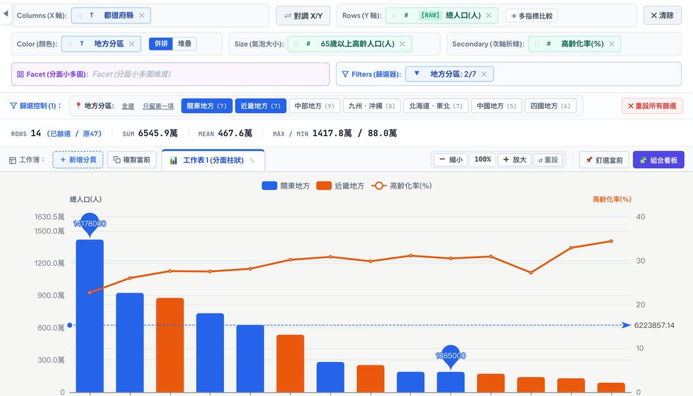


篩選會**同步影響**統計帶、圖表與資料抽屜裡的表格。按「重設所有篩選」可一次還原。

### 槽位操作速查

| 想做的事 | 做法 |
|---|---|
| 指派欄位 | 拖到槽位，或點欄位旁的快捷鈕 |
| 把欄位從一個槽位搬到另一個 | 拖曳槽位裡的膠囊到別的槽位 |
| 移除某個槽位的欄位 | 點膠囊上的 ✕ |
| 互換 X 與 Y | 「⇄ 對調 X/Y」 |
| 全部清空 | 「✕ 清除」 |

## 十一種圖型

「圖表類型」區共 11 張卡片，編號 01–11。**點選卡片就切換圖型**，欄位指派不變。若 X、Y 同時放度量，系統會自動切到 07 散佈圖。

| 編號 | 圖型 | 欄位怎麼放 | 色槽的意思 | 要注意 |
|---|---|---|---|---|
| 01 | 離散體量（長條） | X 維度、Y 度量 | 每類別分組，可併排或堆疊 | 預設由大到小排序 |
| 02 | 時序趨勢（折線） | X 時間或類別、Y 度量 | 每組一條線 | 多指標比較時每個指標一條線 |
| 03 | 雙軸複合 | Y 畫長條，次軸畫折線 | — | 沒指定次軸時，自動挑一個不同的度量 |
| 04 | 地理地圖 | X 放地名，Y 決定顏色深淺 | — | 自動辨識地名體系；或用經緯度欄位 |
| 05 | 盒鬚分佈 | 一個分組維度（X）、一個度量（Y） | 優先當作分組 | 看四分位數與離群值 |
| 06 | 矩形樹圖 | X 放名稱，面積取「大小」槽（沒有就用 Y） | 當作上層分組（階層） | 方塊越大佔比越高 |
| 07 | 相關分佈（散佈） | X、Y 都放度量 | 依類別換色 | 「大小」做成氣泡 |
| 08 | 結構佔比（環形） | X 名稱、Y 數值 | 有色槽時，依該維度加總 Y | 沒有色槽時只取前 15 筆 |
| 09 | 多維畫像（雷達） | 看 X 的名稱 | — | 固定取前 5 筆、資料集的前 6 個度量，不看 Y 槽 |
| 10 | 轉化路徑（漏斗） | X 名稱、Y 數值 | — | 只取前 8 筆，由大到小 |
| 11 | 小提琴圖 | 同 05 | 優先當作分組 | 顯示分佈形狀（核密度）與小箱形 |

```callout warn 取前幾筆的圖型
環形（無色槽時前 15 筆）、雷達（前 5 筆）、漏斗（前 8 筆）只取資料列表**最前面**的幾筆。想看特定幾筆，先用「濾」縮小範圍。
```

### 01 離散體量：長條圖

比較各類別的大小。這是最常用的起點。


### 02 時序趨勢：折線圖

X 放年份或月份，看變化方向。

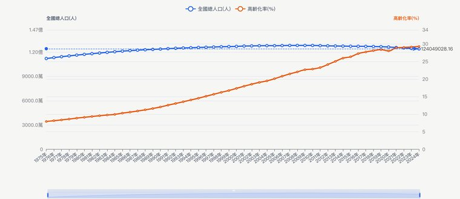

### 03 雙軸複合：長條加折線

長條表示量，折線表示另一個指標，各用自己的刻度。若沒指定次軸，系統會自動挑一個不同的度量（這個例子挑到「65 歲以上高齡人口」）；想看比率，請自己把「高齡化率」拖進次軸。

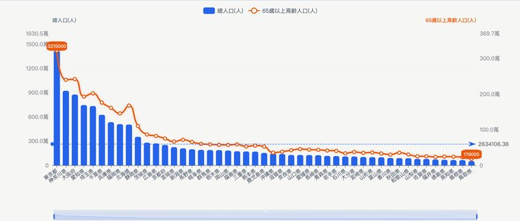

### 04 地理地圖

X 放地名。系統會自動判斷是日本、台灣、世界或美國的地名；資料有經緯度欄位時，則直接用座標。顏色深淺代表 Y 的大小。

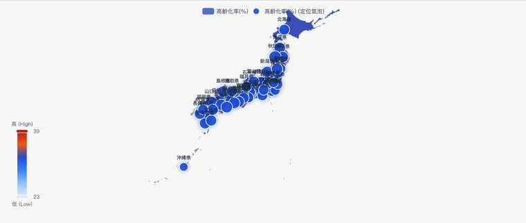

### 05 盒鬚分佈

看每一組數值的分散程度：箱子是中間 50% 的資料，上下鬚是正常範圍，圓點是離群值。

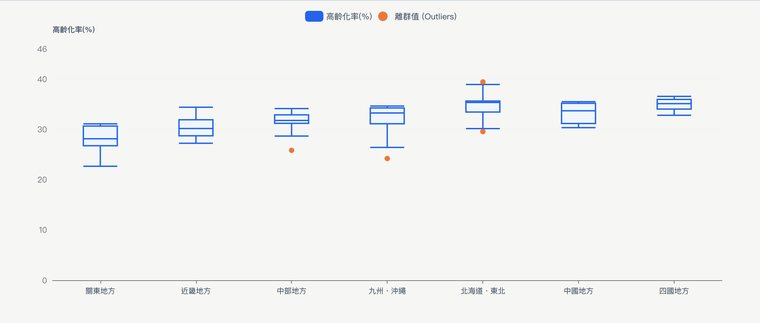

### 06 矩形樹圖

面積代表數量，顏色與外框代表上層分組。

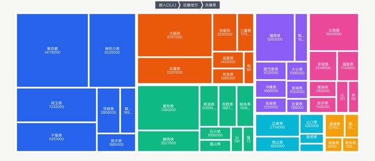

### 07 相關分佈：散佈圖

X、Y 都放度量，看兩個指標有沒有關係。加上「色」分群、加上「大小」變成氣泡圖。

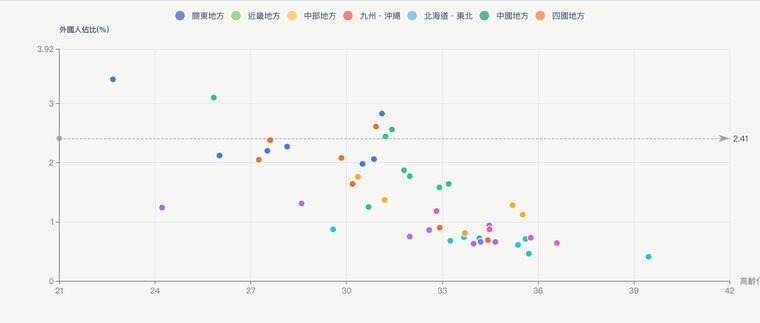

### 08 結構佔比：環形圖

看各部分佔整體的比例。放「色」時，依該維度加總 Y。

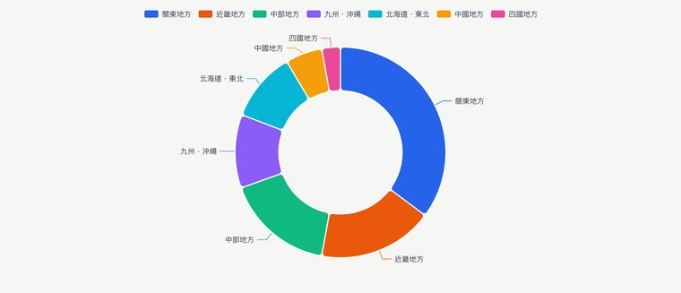

### 09 多維畫像：雷達圖

同時比較多個指標。雷達圖固定取前 5 筆資料、資料集的前 6 個度量。

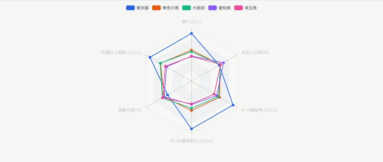

### 10 轉化路徑：漏斗圖

由大到小逐層縮小，適合看流程各階段的留存。

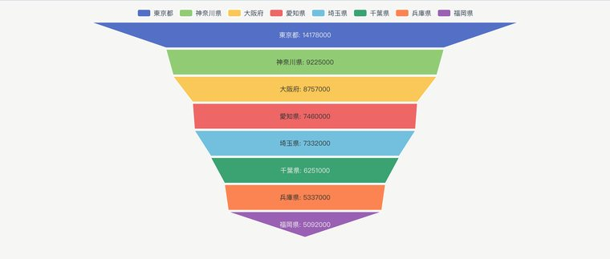

### 11 小提琴圖

比盒鬚圖多看出「分佈的形狀」，例如是否有兩個高峰。

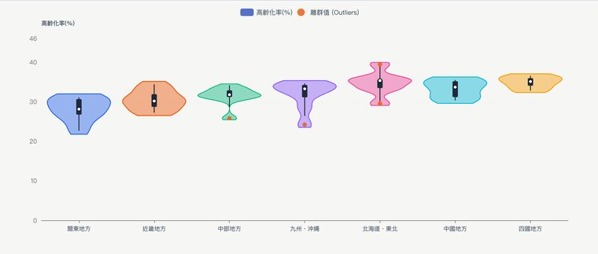

## 多指標比較

想在同一張圖裡比較**好幾個度量**，按 Y 膠囊旁的「＋ 多指標比較」：

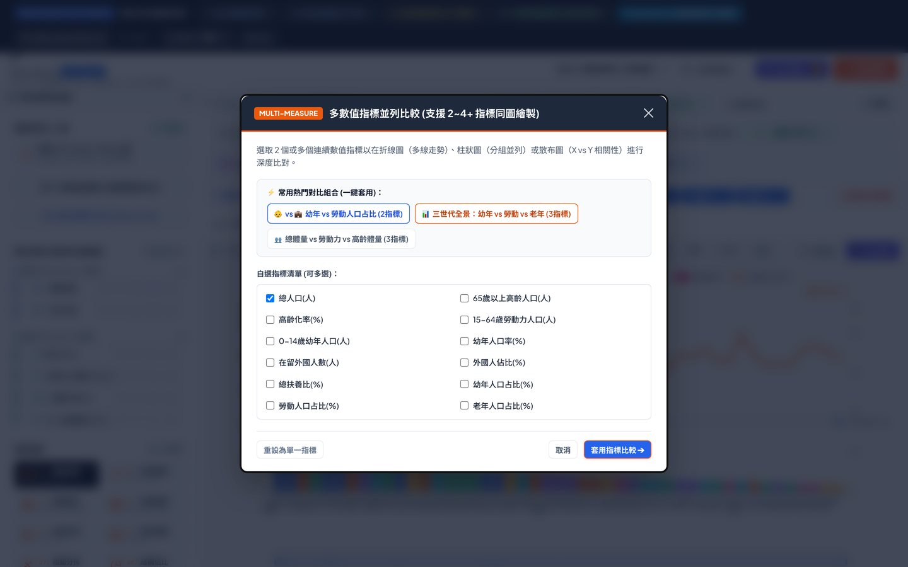

- 點上方的熱門組合（例如「三世代全景：幼年、勞動、老年」）即可套用。
- 也可以在下方自選指標清單勾選。
- 長條圖會變成**分組並列**，折線圖變成**多條線**，兩個指標時散佈圖用「指標 1 對指標 2」。
- 要回到單一指標，按「重設為單一指標」。

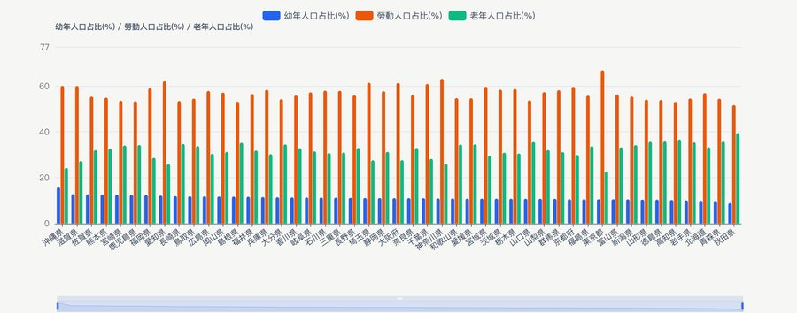

## 工作表、縮放與看板


**工作表分頁**：每個分頁是一張獨立的探索圖。

- 「新增分頁」建立新工作表（實測：沿用目前的 X、Y，圖型預設為折線）。
- 「複製當前」把目前這張圖複製成新分頁，適合在同一組設定上微調。
- 分頁名稱會自動帶上圖型，例如「工作表 1（分面柱狀）」。點分頁上的 ✎（或雙擊分頁）可改名，點 ✕ 關閉。

**縮放**：「縮小」「放大」在 75%、90%、100%、125%、150% 之間切換，「重設」回到 100%。

**釘選與看板**：

1. 在喜歡的圖按「📌 釘選當前」，右上「自訂看板」的數字會加一。
2. 按「🧩 組合看板」打開看板，可選 1、2 或 3 欄排版。
3. 看板內可「載入工作簿所有分頁」「釘選當前圖表」，也能「清空看板」。

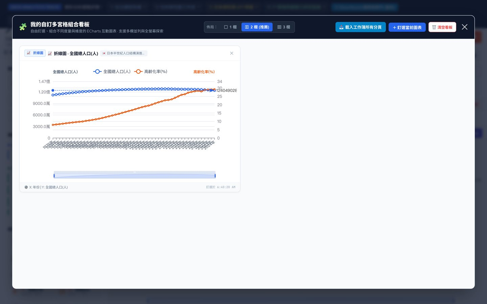

**匯出圖表**：右上橘色按鈕，匯出 1080p 高清圖片。

**圖表引擎**：「工具與設定 → 切換圖表引擎」可在 ECharts（高互動向量）與 Canvas（點陣渲染）之間切換；預設是 ECharts，若 ECharts 沒載入成功會自動改用 Canvas。

## 資料來源

### 內建資料集

資料集選單共 13 項：12 組內建資料集（分三類，見下表），加上第一項「自選 17 大領域指標」。

| 類別 | 內容 |
|---|---|
| 日本官方統計 e-Stat | 12 大城市的性別、人口、所得與三代結構；47 都道府縣的人口與高齡化、房價地價；半世紀人口演進；地方分區彙總 |
| 台灣與全球 | 台灣 22 縣市房價地價；全球主要經濟體 GDP、人均所得、人口、通膨 |
| 商業營運測試資料 | 產品線營收與毛利、12 個月營收趨勢、行銷廣告與獲客相關 |

「自選 17 大領域指標」見下一節。

### 17 大領域下載器

從日本官方統計自選指標與年份，產生自己的資料表：


1. 上方選年份區間：「2024 最新基準年」「近 5 年」「近 10 年」「近 20 年」「半世紀」，或自訂起訖年；旁邊可選「逐年」或「每 5 年」。
2. 左側選領域（A–Q），右側勾選指標；每個領域有「全選該領域」「清除」「推薦核心」。
3. 下方會顯示已勾選的指標數與預計產生的列數，可「下載 CSV」「下載 JSON」，或「載入至視覺化工作台」。載入後會先進入欄位分類，再開始繪圖。

### 上傳自己的檔案

把 CSV、Excel（.xlsx、.xls）或 JSON 拖進左側「數據來源 & 上傳」區塊。依介面標示，上傳的資料在瀏覽器本機運算。

### 資料抽屜

按圖表區下方的「數據明細預覽」展開。

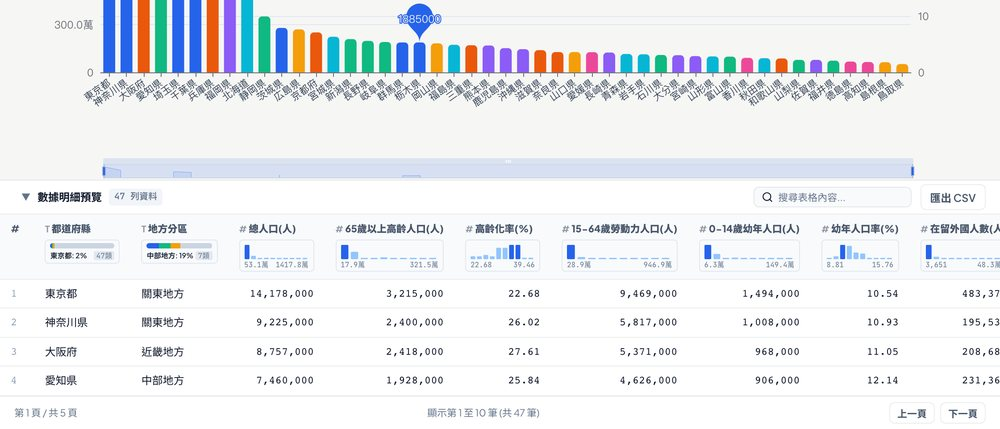

- 每個欄位標題下有分佈小圖，先看出資料的集中與離散。
- 搜尋框可過濾列；分頁按鈕翻頁（每頁 10 筆）。
- 「匯出 CSV」匯出的是**目前篩選與搜尋後**的資料。

```callout info 資料抽屜展開後要往下捲
抽屜展開後會往下延伸，要把圖表區往下捲，才看得到表格。
```

## 數據動態簡報

「工具與設定 → 數據動態簡報」開啟簡報導演台：

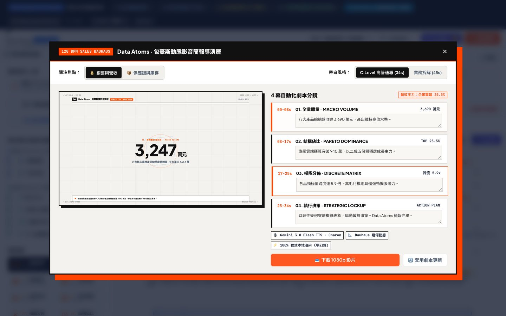

- **關注焦點**：「銷售與營收」或「供應鏈與庫存」，切換後 4 幕分鏡的內容會跟著換。
- **旁白風格**：「C-Level 高管速報」或「業務拆解」。
- 分鏡文字可直接編輯。按「套用劇本更新」套用修改（實測：同時會重新載入對應的示範資料與圖表）。
- 「下載 1080p 影片」取得簡報影片。

## 儲存與重設

工作台會把你的操作**自動存在這個瀏覽器裡**（localStorage），關掉分頁再開，仍會回到上次的狀態。存起來的內容包含：各工作表的槽位與篩選、目前使用的分頁、釘選的圖表、縮放比例與看板的欄數。

- 資料只留在這台電腦的這個瀏覽器；換瀏覽器或清除瀏覽器資料就會消失。
- 想回到出廠狀態：「工具與設定 → ↺ 還原預設工作簿」，會清除自訂工作表與快取。

## 配置速查表

下表每一列都用目前的介面實際驗證過。

| 分析目標 | 資料集 | X | Y | 其他槽位 | 圖型 |
|---|---|---|---|---|---|
| 各縣人口排行 | 47 都道府縣 | 都道府縣 | 總人口 | — | 01 長條 |
| 人口與高齡化並看 | 47 都道府縣 | 都道府縣 | 總人口 | 次軸：高齡化率 | 03 雙軸 |
| 各地區人口佔比 | 47 都道府縣 | 都道府縣 | 總人口 | 色：地方分區 | 08 環形 |
| 高齡化與外國人比例有關嗎 | 47 都道府縣 | 高齡化率 | 外國人佔比 | 色：地方分區；大小：總人口 | 07 散佈 |
| 各地區高齡化分佈 | 47 都道府縣 | 地方分區 | 高齡化率 | — | 05 盒鬚或 11 小提琴 |
| 各縣在地圖上的高齡化 | 47 都道府縣 | 都道府縣 | 高齡化率 | — | 04 地圖 |
| 各區內部排名 | 47 都道府縣 | 都道府縣 | 總人口 | 面：地方分區（獨立量表） | 01 長條 |
| 男女人口對比 | 12 大城市（性別・人口・所得） | 城市 | 總人口 | 色：性別 | 01 長條（併排／堆疊） |
| 人口半世紀趨勢 | 半世紀人口演進 | 年份 | 全國總人口 | — | 02 折線 |

## 避坑與常見問題

```callout warn 長條圖看起來不對？先檢查三件事
1. **聚合方式**：Y 的標籤是 RAW、SUM 還是 MEAN？比率類欄位（如高齡化率）加總沒有意義，請用 MEAN。
2. **篩選器**：統計帶出現「已篩選／原 N」，代表有篩選在作用。按「重設所有篩選」。
3. **槽位殘留**：切換資料集後，色、大小、次軸可能已有預設值。按「✕ 清除」從空白開始。
```

| 問題 | 原因與做法 |
|---|---|
| 放了「面」，圖沒有分成小圖 | 只有長條圖與折線圖支援分面，且面的類別至少 2 個 |
| 小圖裡一大半是空的 | X 與面放了有從屬關係的維度；改用獨立量表，或換一個面維度 |
| 雷達、漏斗、環形圖只出現少數幾筆 | 這三種圖只取前 5、8、15 筆；先用「濾」縮小範圍 |
| 雙軸圖的折線不是我要的指標 | 沒指定次軸時系統自動挑；自己把要的度量拖進次軸 |
| 大資料時圖變成加總 | 超過 5,000 列且為 RAW 時自動加總；點聚合標籤改成別的方式 |
| 關掉再開，圖表還在 | 正常：工作台會自動存在瀏覽器；要重來請「還原預設工作簿」 |
| 頁面字型看起來不一樣 | 標題字型向 Google Fonts 載入，離線時外觀可能不同，不影響資料與運算 |

```kv cols=2
手冊產生方式: 由 docs/manual_source.md 產生
截圖: scripts/capture_manual_images.py 以目前介面自動擷取
更新流程: 見 docs/MANUAL_BUILD.md
```
